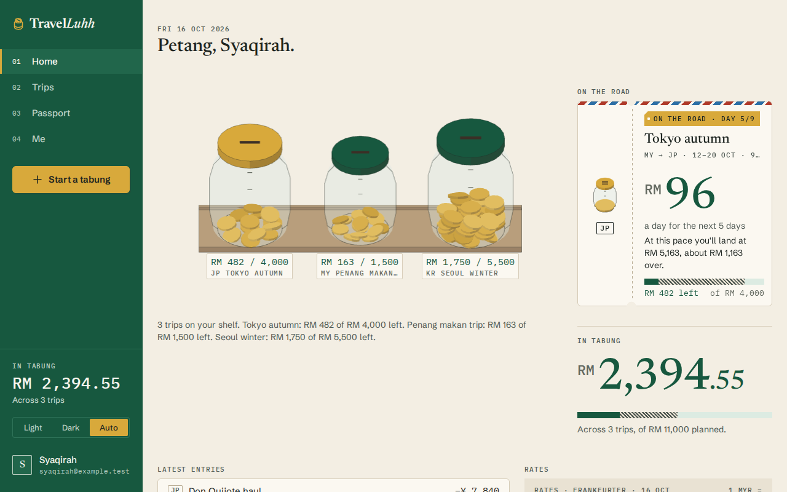
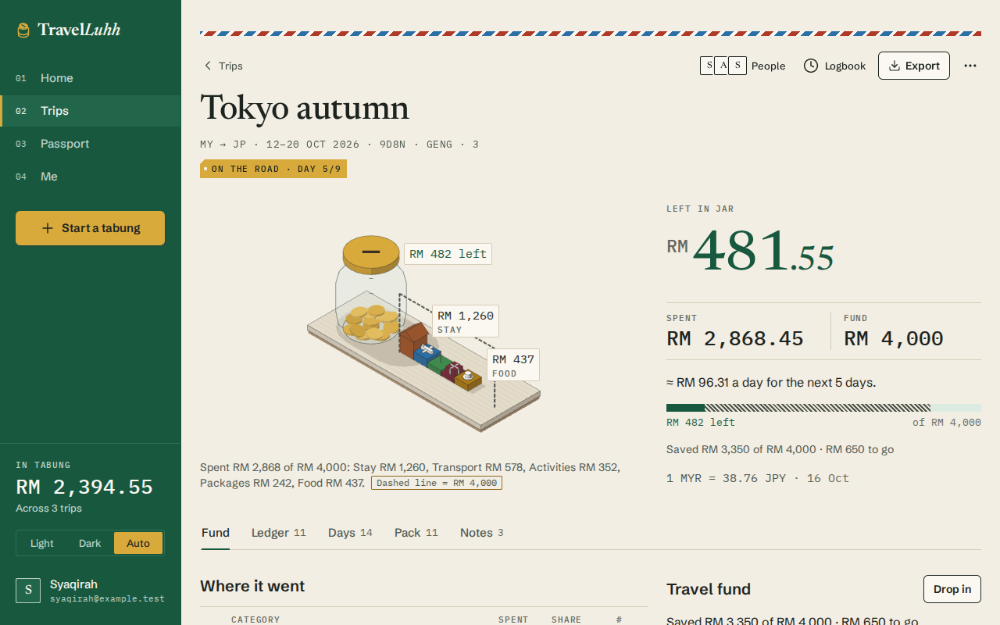
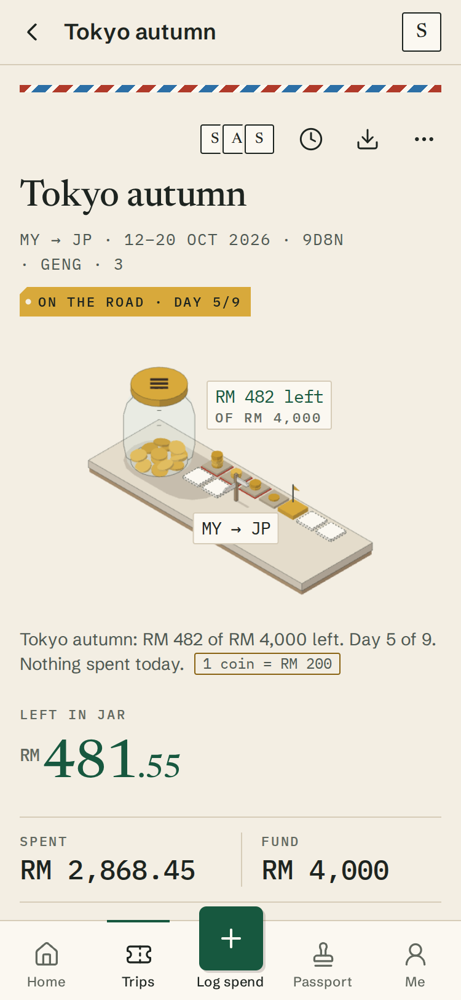
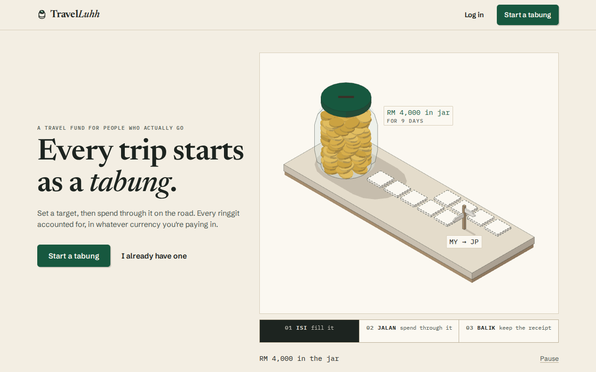

# TravelLuhh

Every trip starts as a *tabung*.

TravelLuhh is a travel fund and trip planner. You set a target for a trip, fill the jar before you go, and spend
through it on the road — every ringgit accounted for, in whatever currency you're actually paying in. When you're
home, the trip gets a passport stamp and whatever's left over is your *baki*.

<p>
  
</p>

<p>
  
  
  
</p>

## What it does

- **A jar per trip.** The isometric scenes are drawn from your real numbers: the coins in the jar are what's left,
  the day stones on the plinth carry each day's spend, the category blocks next to the jar add up to the budget.
  No numbers are decorative.
- **Save up first.** Drop money into a trip's fund before you leave ("Save RM 175 a week until 12 Nov"). Once
  you're travelling, the daily allowance and pace line tell you what you can still enjoy.
- **Log spend in any currency.** Pay ¥3,200 for ramen and the ledger shows `≈ RM 98.73` at today's rate (live
  rates from Frankfurter). Trip totals are always in one currency.
- **Passbook ledger.** Every entry with a running balance (*BAKI*), grouped by day, with undo on delete and edit.
- **Days, Pack, Notes.** A day-by-day itinerary on a transit-line timeline, a packing list with quick packs
  (General, Beach, Hiking, Business, Umrah & Hajj) that fills an isometric suitcase, and notes saved to the trip.
- **Geng trips.** Invite friends by email as editors or viewers. *One pot* trips settle up with the fewest
  transfers ("Copy for WhatsApp"); *own money* trips give everyone their own jar and allocation.
- **Passport.** Trips you've come home from become houses in your *kampung*, plus stamps per country and a
  year-by-year baki.
- Email sign-up with a 6-digit code, or Google. Light and dark ("night market") themes. Works on a 375px phone.

## Stack

| | |
|---|---|
| Frontend | React 18, TypeScript, Vite, Tailwind, Radix/shadcn (restyled), TanStack Query |
| 3D | three.js + @react-three/fiber, all geometry procedural, lazy-loaded, with SVG twins as fallback |
| Backend | Spring Boot 3.2, Java 17, Spring Security (JWT + Google OAuth2), Spring Data JPA |
| Database | PostgreSQL (Neon in the cloud; any Postgres 15+ locally) |
| Other | Gmail SMTP for codes, Frankfurter for exchange rates |

## Running it locally

You need Docker and Node 18+. Java isn't required locally; the backend builds inside Docker.

**1. Configure the backend.** Copy `backend/src/main/resources/application.example.yml` to `application.yml` in
the same folder (it's gitignored) and fill it in, or keep the `${ENV_VAR}` placeholders and put the values in
`backend/.env`. You need a Postgres URL, a JWT secret (`base64:` + `openssl rand -base64 48`), Gmail SMTP
credentials for sign-up codes, and optionally Google OAuth credentials.

**2. Create or migrate the database.**

```bash
# fresh database
psql "$DB_URL" -f backend/schema.sql

# existing database from before October 2026
psql "$DB_URL" -f backend/migrations/002_revamp.sql
```

The migration is idempotent, so running it twice is fine. The backend checks the schema at startup and refuses to start
with a clear message if the migration hasn't been applied (`SCHEMA_CHECK=warn` to only log).

**3. Start everything.**

```bash
docker compose up --build -d          # API on http://localhost:8080

cd frontend
cp .env.example .env                  # VITE_API_BASE_URL=http://localhost:8080/api
npm install
npm run dev                           # http://localhost:5173
```

The dev server runs on 5173 because that's the origin the backend allows by default (`CORS_ORIGINS`) and where
the Google sign-in redirect lands (`FRONTEND_URL`).

## Tests and checks

```bash
cd frontend
npm run typecheck      # tsc, also run by `npm run build`
npm run lint
npm run lint:look      # design guardrails: no gradients, blur, emoji, rounded-xl, banned icons
npm test               # vitest

# backend unit tests, inside Docker
docker run --rm -v "$PWD/backend":/app -w /app maven:3.9-eclipse-temurin-17 mvn -q test
```

## How it's put together

```
backend/src/main/java/com/travelluhh/
  controller/   REST endpoints, thin
  service/      business rules; TripAccessService checks membership and role for every trip-scoped call
  entity/ repository/ dto/
  security/     JWT filter (access tokens only), token service (rotating refresh tokens), OAuth2 handlers
  config/       SchemaCheck
backend/schema.sql               full schema for a new database
backend/migrations/              changes for existing databases

frontend/src/
  pages/        one file per route
  components/   motifs/ (ticket, passbook, stamp…), glyphs/ (isometric icons), trip/, ledger/, home/, …
  iso/          the isometric engine: projection, face-tone material, primitives, mappers (data → scene spec),
                scenes (three.js) and their SVG twins, IsoStage
  hooks/ services/ lib/   data layer (TanStack Query), money/date/phase helpers
  design/tokens.ts        colour tokens shared by CSS and the 3D scenes
```

A few rules the code relies on:

- Money on a trip is always in the trip's currency. Foreign-currency spends are converted when they're logged;
  the original amount, currency and rate are kept with the expense.
- `trips.spent_amount`, `trip_member_budgets.spent_amount` and the `remaining_budget` columns are maintained by
  database triggers. The application never writes them.
- Deletes are hard deletes.
- Non-members get a 404 for a trip; members without the right role get a 403. Viewers can read everything and
  change nothing.

## Not built yet

- Transferring trip ownership, and invite links for people without an account.
- Real-time updates between people on the same trip (changes show on refresh or refocus).
- Trip cover images and a public read-only trip view.
- Budget alert emails.

## License

MIT © 2025 Siti Nursyaqirah
